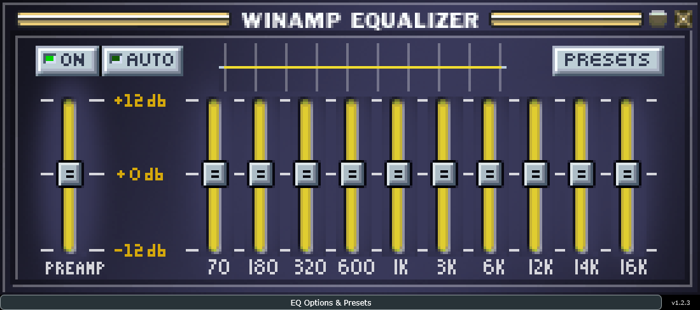

# Winamp Classic Equalizer

[Install with OpenVST Manager](https://github.com/alanmarcero/alan-m-OpenVSTManager/releases/latest)

## Beta

All of these plugins are in beta. The macOS and Linux builds are not up to date, so the Windows build is the one to use for now. A plugin can change dramatically from one release to the next, but the goal is for each one to keep getting better.

A familiar 10-band equalizer for shaping tracks in a DAW. Winamp Classic Equalizer brings the look and hands-on feel of Winamp’s original equalizer to music production, with the controls needed for quick tone changes and detailed balancing.

## Features

- Shape a sound with ten frequency bands and a separate preamp control.
- Choose the classic Winamp frequency layout or an ISO frequency layout.
- Switch between Winamp’s 4Front and Constant-Q equalizer tones.
- Use 18 built-in presets, including familiar genre and listening curves.
- Load and save Winamp equalizer presets.
- View changes on the response graph, drag across bands, or set all bands to a quick gain curve.
- Load a classic Winamp skin, use Windowshade mode, and resize the window from 1× to 5×.
- Save settings with the DAW project and automate the main sound controls.

## Use it in your DAW

Install the VST3 with [OpenVST Manager](https://github.com/alanmarcero/alan-m-OpenVSTManager/releases/latest), or download the latest package from [GitHub Releases](https://github.com/alanmarcero/winamp-classic-equalizer-vst/releases/latest). It is available for VST3-compatible DAWs on macOS and Windows.
