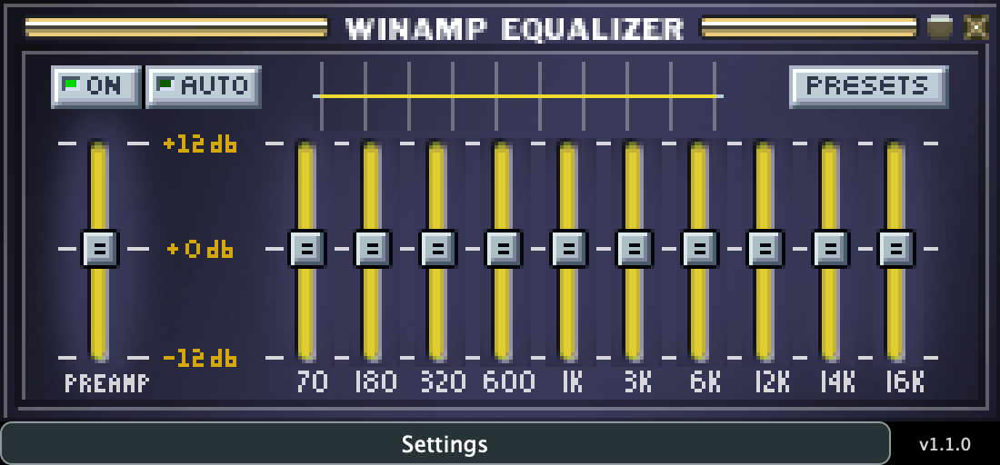

# Native UI screenshot

`assets/native-ui.png` was captured on macOS on 2026-10-27 from the actual **v1.1.0 VST3 editor**, loaded in a JUCE 8.0.9 host. It shows the plugin's default state while processing a stereo test signal at 48 kHz with a 120 BPM host transport. The host renders the native AppKit view into a PNG at the display's backing resolution (1100 × 512). Controls, labels, meters and version text come from the running plugin.

- [Release v1.1.0](https://github.com/alanmarcero/winamp-classic-equalizer-vst/releases/tag/v1.1.0)
- Source commit: [`63939f2`](https://github.com/alanmarcero/winamp-classic-equalizer-vst/commit/63939f2d50f8829c50928120e7c7591878757422)
- Release asset: `WinampClassicEqualizer-VST3-macOS.zip`
- Archive SHA-256, verified before capture: `a3fabc2020a1709cedef8f0812c53fd307c75feae29d0183fd30f30936810080`
- Screenshot SHA-256: `67e2bf17aa64081ae01befc458bff36c0573bb533bf9f5653b97df55d54496d3`
